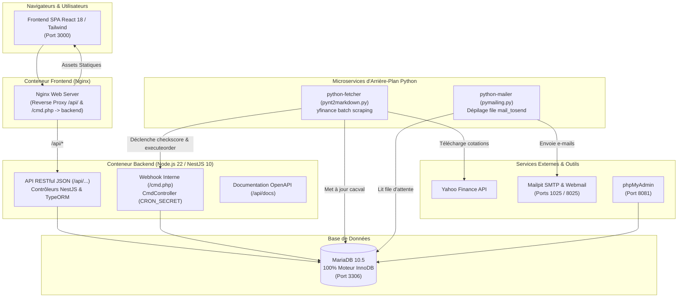

# NetTrader 2 — Plateforme & Jeu de Simulation Boursière

[](https://nodejs.org/)
[](https://nestjs.com/)
[](https://react.dev/)
[](https://www.typescriptlang.org/)
[](https://tailwindcss.com/)
[](https://www.docker.com/)
[](https://mariadb.org/)
[](https://www.python.org/)

---

## 📈 Présentation du Projet

**NetTrader 2** est une plateforme de jeu et de simulation boursière complète, permettant à chacun de s'initier aux marchés financiers sans engager de capital réel.

Chaque joueur démarre avec un capital virtuel de **10 000 €** et doit bâtir la stratégie la plus performante pour grimper au classement général individuel ou par équipes.

### Points Clés du Jeu :
- **Cotations réelles en continu** : Intégration des cours réels (indices Euronext, actions internationales) avec un différé de 15 minutes, rafraîchis en continu.
- **Gestion des ordres de bourse** : Ordres au marché, à cours limité, et à seuils / plages de déclenchement.
- **Règles financières réalistes** : Frais de courtage et taxes proportionnelles, calcul des plus ou moins-values latentes et réalisées.
- **3 Niveaux d'expertise** :
  - *Débutant* : Achat et vente au comptant de titres en portefeuille.
  - *Initié* : Déblocage des ordres à cours limité et à seuils.
  - *Expert* : Vente à découvert (VAD) et effet de levier sur marge disponible.
- **Dimension Communautaire & Sociale** : Classements dynamiques, création et adhésion à des équipes (groupes), messagerie privée entre traders, et forums de discussion avec modération intégrée.

---

## 🏛️ Architecture du Système

Le projet a fait l'objet d'une **refonte et modernisation intégrale**, remplaçant définitivement l'ancienne pile PHP procédurale par une **architecture moderne multi-conteneurs 100% TypeScript / Node.js & Python** :



---

## 🚀 Récapitulatif des Évolutions & Architecture Moderne

### 1. Application Frontend (SPA React / TypeScript / Tailwind)
- **Stack moderne** : React 18, TypeScript, Tailwind CSS, Lucide Icons, Vite, Nginx.
- **Routage complet & Expérience fluide** :
  - **Accueil & Marchés** : Ticker boursier animé, vue d'ensemble du marché, top hausses / baisses.
  - **Fiche Valeur & Graphiques** : Cotation en temps réel, détails financiers et graphiques d'évolution interactifs.
  - **Portefeuille & Trading** : Valorisation totale, liquidités disponibles, tableau des positions, modal interactif d'achat/vente avec simulation des frais et contrôle des contraintes par niveau.
  - **Ordres en attente & Historique** : Suivi des ordres en carnet, annulation unitaire ou globale, historique des transactions et des profits/pertes.
  - **Classements** : Palmarès des meilleurs traders et classement des équipes.
  - **Forums & Discussions** : Rubriques thématiques, affichage des sujets, éditeur de messages avec support du BBCode (liens, citations, formatage) et gestion modérateur/administrateur.
  - **Messagerie & Profil** : Messagerie privée interne, gestion des paramètres, réinitialisation de compte et changement sécurisé de mot de passe.
  - **Administration Complète** : Dashboard d'administration, synchronisation des ordres, modération du forum, **Catalogue & Gestion des Actions** (création, édition, blocage d'achat, opérations de split/regroupement sur les portefeuilles, suppression sécurisée) et **espace dédié au suivi des cotations (Market Sync Monitor)** avec indicateurs en direct.

### 2. Architecture Backend 100% NestJS / TypeScript
- **Framework d'entreprise** : NestJS 10, TypeORM, Express, TypeScript 5.4.
- **Séparation par Modules** :
  - `AuthModule` : Authentification, sessions sécurisées CSPRNG, BCRYPT, guards de rôle.
  - `TradingModule` : Gestion du portefeuille, valorisation VAD/comptant, matching et exécution des ordres.
  - `MarketModule` : Cotations boursières, agrégations, fiches titres.
  - `LeaderboardModule` : Palmarès des joueurs et équipes.
  - `AccountModule` : Profil utilisateur, mise à jour des coordonnées et paramètres.
  - `TeamModule` : Gestion des équipes et candidatures.
  - `ForumModule` & `MessageModule` : Discussions, sujets, posts et messagerie privée.
  - `AdminModule` : Supervision, modération, synchronisation des marchés, et émulation `/cmd.php`.
- **Documentation d'API intégrée** : Swagger OpenAPI accessible sur `/api/docs`.

### 3. Durcissement & Sécurité Critique
- **100% Requêtes Préparées & ORM Typé** : Protection native contre les injections SQL via TypeORM.
- **Transactions ACID & Verrous Pessimistes** : Transactions de trading protégées contre les *race conditions*.
- **Hachage BCRYPT** : Chiffrement robuste des mots de passe.
- **Protection XSS Systématique** : Assainissement strict et validation DTO `class-validator`.
- **Protection des Webhooks** : Sécurisation de `cmd.php` par clé secrète `CRON_SECRET` avec comparaison en temps constant (`timingSafeEqual`).
- **Isolation Réseau & Reverse Proxy Nginx** : Exposition unifiée via Nginx sur le port 3000.

### 4. Microservice de Cotation Boursière (`python-fetcher`)
- Scraping en continu des cotations réelles via la librairie **`yfinance`** en Python 3.
- Traitement optimisé par lots de 50 symboles avec repli unitaire automatique.
- Déclenchement automatique des calculs de portefeuilles et de l'exécution des ordres via webhook `cmd.php` sur le backend NestJS.

---

## 📦 Démarrage Rapide avec Docker

### Prérequis
- [Docker](https://docs.docker.com/get-docker/) (version 20.10+)
- [Docker Compose](https://docs.docker.com/compose/) (version 2.0+)

### 1. Lancement de la Stack Complète
Clonez le dépôt et démarrez tous les conteneurs en arrière-plan :

```bash
git clone https://github.com/tetrok/nettrader.git
cd nettrader
docker compose up -d
```

### 2. URL et Services Disponibles

| Service | Rôle | URL / Port | Identifiants par défaut |
| :--- | :--- | :--- | :--- |
| **Frontend SPA** | Interface utilisateur moderne React 18 | [http://localhost:3000](http://localhost:3000) | — |
| **Backend & API** | Serveur NestJS 10 / Node.js 22 | [http://localhost:3001/api/docs](http://localhost:3001/api/docs) | — |
| **phpMyAdmin** | Administration visuelle de la base MariaDB | [http://localhost:8081](http://localhost:8081) | Utilisateur : `root` / Mot de passe : `rootpassword` |
| **Mailpit Web UI** | Visualiseur d'e-mails pour le développement | [http://localhost:8025](http://localhost:8025) | — |
| **Mailpit SMTP** | Serveur SMTP interne pour les e-mails | `localhost:1025` | Sans authentification |
| **MariaDB** | Serveur de base de données relationnelle | `localhost:3306` | Base : `nettrader`, User : `nettrader_user`, Pass : `nettrader_password` |

---

## 🧪 Tests Automatisés

Une suite complète de **46 tests d'intégration et de sécurité** est intégrée au projet. Elle valide le fonctionnement des règles métier, des contrôles d'accès, de l'API REST et des mécanismes de durcissement.

Pour exécuter la documentation interactive et tester les endpoints de l'API :
- Accédez à l'interface Swagger OpenAPI sur : [http://localhost:3001/api/docs](http://localhost:3001/api/docs)

### Couverture des Fonctionnalités Backend :
- **Règles Métier `TradingService`** : Refus de vente d'actions non possédées, blocage des ordres hors plage pour les débutants, vérification stricte du solde de liquidités, engagement des actions en carnet d'ordres.
- **Endpoints REST Trading** : Validation des codes HTTP 400 sur requêtes invalides, annulation d'ordres 404/200.
- **Gestion des Comptes & Profils** : Préservation des données non fournies, validation des niveaux, vérification de l'ancien mot de passe, révocation immédiate des sessions annexes.
- **Gestion des Équipes & Messagerie** : Validation des contraintes de taille, invitations de groupe, prévention de l'envoi de message à soi-même, protection contre les caractères spéciaux.
- **Parseur BBCode & Forums** : Support des syntaxes d'URL, citations, neutralisation des vecteurs d'attaque XSS `javascript:`.
- **Modération & Administration** : Contrôles de permissions strictes (HTTP 403 aux utilisateurs non-admin), création, édition, synchronisation des compteurs et suppression de rubriques/sujets.
- **Sécurité & Durcissement** : Authentification obligatoire par clé secrète sur `cmd.php` (HTTP 403), entropie des jetons de session (CSPRNG 256 bits), migration 100% InnoDB, politique CORS restrictive.
- **Suivi des Cotations & Supervision Marché (Market Sync)** : Rejet HTTP 403 pour non-administrateurs, consultation de la vue d'ensemble (KPIs et logs récents), listing paginé avec indicateurs de statut, filtrage par statut (`failed`, `success`, `pending`), réinitialisation unitaire et globale des compteurs d'échecs, basculement dynamique du suivi d'un titre (`toggle-track`).

---

## 📁 Structure du Répertoire

```text
.
├── docker-compose.yml          # Définition de l'ensemble des conteneurs
├── mysql_dump.sql              # Schéma de base de données et données initiales (InnoDB)
├── .jules/                     # Documentation technique détaillée, plans et audits
│   ├── plan.md                 # Feuille de route et suivi d'avancement
│   ├── dette.md                # Inventaire des dettes techniques
│   ├── api-fonctionnalites.md  # Spécifications des flux et des fonctionnalités
│   ├── faille-xss.md           # Rapport de remédiation des failles XSS
│   └── failles-injections.md   # Rapport de remédiation des injections SQL
├── backend/                    # Backend API REST moderne (Node.js 22 / NestJS 10)
│   ├── Dockerfile              # Multi-stage build Node.js Alpine
│   ├── package.json            # Dépendances NestJS, TypeORM, MySQL2, class-validator
│   └── src/                    # Modules NestJS (auth, trading, market, forum, admin, etc.)
├── frontend/                   # Application SPA React / TypeScript
│   ├── src/
│   │   ├── api/                # Clients d'API typés (auth, trading, forums, admin...)
│   │   ├── components/         # Composants d'interface (Navbar, OrderModal, StockChart...)
│   │   ├── context/            # Contexte d'authentification (AuthContext)
│   │   ├── pages/              # Pages de l'application (Portfolio, Market, Forums...)
│   │   └── router.tsx          # Configuration des routes et guards d'authentification
│   ├── nginx.conf              # Configuration Nginx et reverse proxy /api/ & /cmd.php
│   └── Dockerfile              # Multi-stage build Node -> Nginx
└── pythonfetch/                # Microservices d'arrière-plan Python
    ├── pynt2markdown.py        # Récupération des cours Yahoo Finance et synchronisation
    ├── pymailing.py            # Traitement de la file d'envoi d'e-mails
    ├── pynt2stats.py           # Calcul des statistiques de jeu
    └── Dockerfile              # Image Python 3 avec yfinance, pandas, pymysql
```

---

## 📚 Documentation Additionnelle

Pour approfondir les aspects d'architecture et de sécurité, consultez les documents du répertoire [`.jules/`](.jules/) :
- [`.jules/plan.md`](.jules/plan.md) : Plan d'action détaillé et matrice de suivi des chantiers.
- [`.jules/dette.md`](.jules/dette.md) : État des lieux de la dette technique et résolutions effectuées.
- [`.jules/api-fonctionnalites.md`](.jules/api-fonctionnalites.md) : Architecture des flux et spécification détaillée des fonctionnalités.
- [`.jules/failles-injections.md`](.jules/failles-injections.md) : Détail de la remédiation systématique des injections SQL.
- [`.jules/faille-xss.md`](.jules/faille-xss.md) : Stratégie d'assainissement et protection contre les attaques XSS.

---

## 📄 Licence

Ce projet est distribué sous la licence spécifiée dans le fichier [LICENSE](LICENSE).
